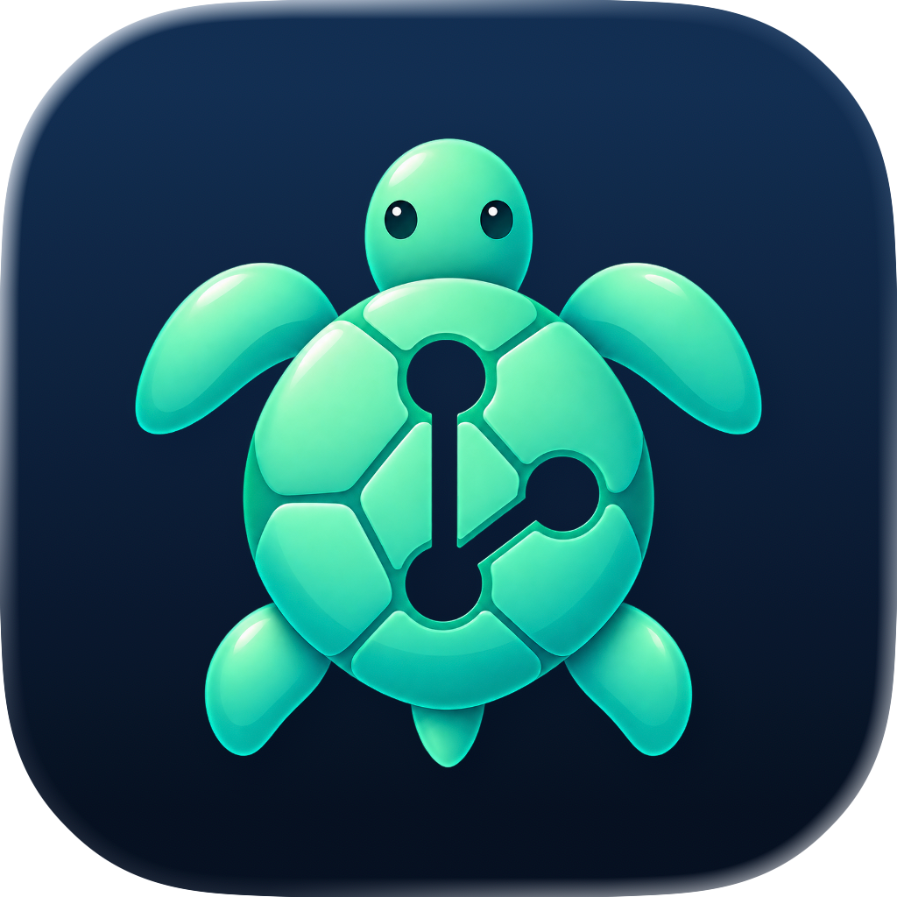
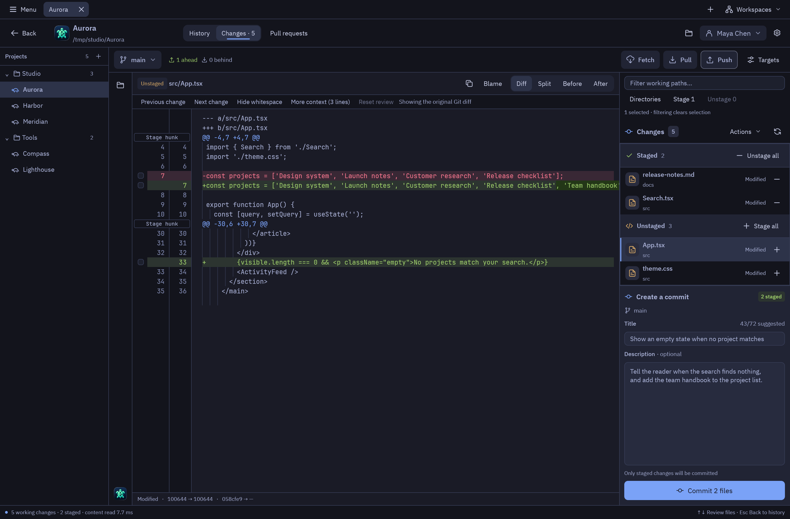
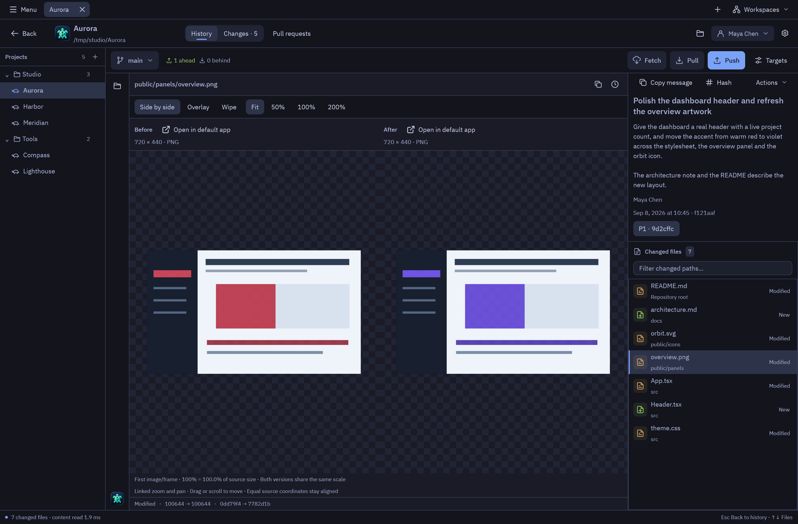
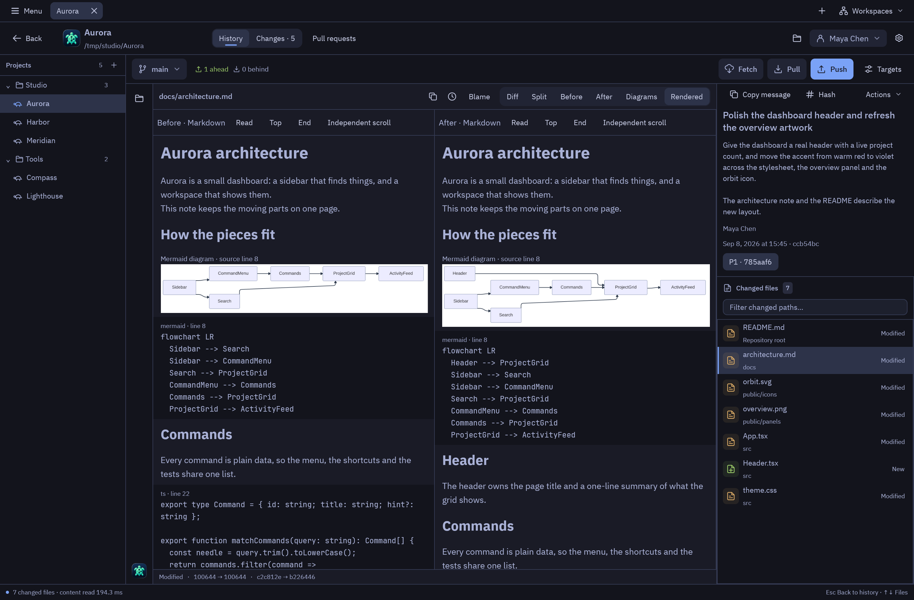
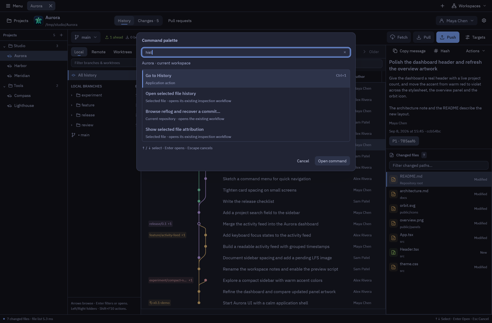
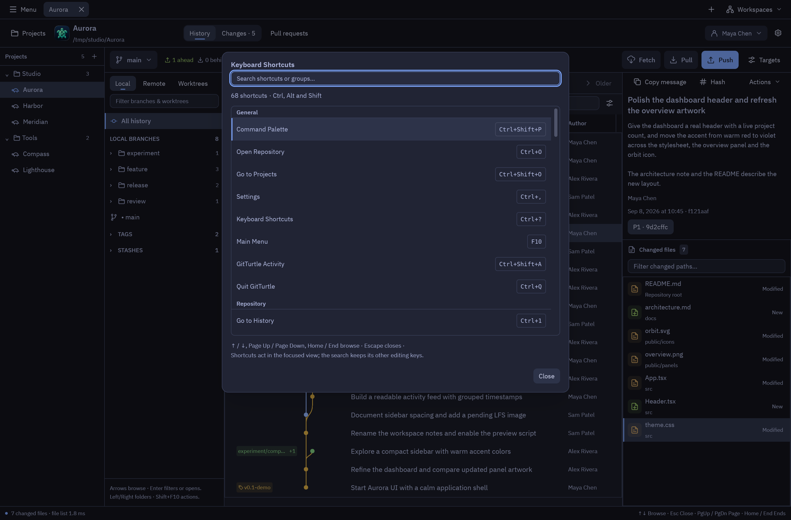

<p align="center"></p>

<h1 align="center">GitTurtle</h1>

<p align="center"><b>A fast, native Git client for macOS and Linux.</b><br>History, review and everyday Git work in one window.</p>

<p align="center">
  <a href="https://gitturtle.com/">Website</a> ·
  <a href="#a-tour-in-a-minute">Features</a> ·
  <a href="#themes">Themes</a> ·
  <a href="#first-class-omarchy-support">Omarchy</a> ·
  <a href="#get-started">Get started</a> ·
  <a href="#platform-status">Platforms</a> ·
  <a href="docs/user-guide.md">User guide</a> ·
  <a href="SUPPORT.md">Get help</a>
</p>

<p align="center"><a href="https://github.com/FernandoX7/GitTurtle/actions/workflows/quality.yml"></a></p>

GitTurtle is a Git client for anyone on **macOS or Linux** who reads history, reviews changes and commits every day. It is built with Rust and GPUI and draws its own native window, with no Electron, no web view and no AI features, and it works with the Git you already have installed.

<p align="center"></p>

<p align="center"><i>Every screenshot on this page shows a disposable demo repository, captured natively on Linux.</i></p>

- **Fast.** A release build has its window up in a median of 115 ms, a selected commit's changed files ready in 21 ms, and a file's diff ready in 5 ms. Each figure is a [recorded measurement](#measured).
- **Built to stay fast.** Repository reads, diffs, parsing and image decoding run off the UI thread. Lists draw only the rows on screen, a commit's details load before any file content, and history keeps at most 5,000 rows or 64 MiB loaded however deep you page.
- **Feature-rich.** A commit graph, staging by hunk and line, unified and split diffs, blame and line history, interactive rebase, conflict resolution, stashes, worktrees, GitHub pull-request review, twenty built-in themes, and previews for images, PDF, Markdown, diagrams and 3D models.
- **Careful with your repository.** Browsing stays local and read-only and never fetches. Writes and network requests start only when you ask, and Git keeps your hooks, signing and credential helpers.

### Measured

| In a release build | Median | 95th percentile |
| --- | ---: | ---: |
| Select a commit, until its changed-file list is ready | 21.2 ms | 45.2 ms |
| Open a text file from history, until its diff is ready | 4.9 ms | 7.4 ms |
| Load each further page of 500 commits in a 120,000-commit history | 0.5 ms | 0.6 ms |
| Scroll a 3,000-commit history: UI-thread time per wheel notch | 8.2 ms | 13.2 ms |

The first two rows are traces from the app on a 653-commit test repository, on an Apple M4 Max ([record](docs/benchmarks/2026-09-08-everyday-workflows.md)). The third is a backend benchmark on the same machine ([record](docs/benchmarks/2026-09-10-history-pagination.md)). The fourth was taken in a 1480 × 800 window on an Apple M2 Pro running Linux ([record](docs/benchmarks/2026-10-27-compact-chrome-history-scroll.md)). None of the four includes input delivery or display presentation. The launch figure comes from nine warm launches on that M2 Pro, 103 to 135 ms from start to a mapped window ([record](docs/validation.md#october-27-the-linux-interface-draws-its-real-weights)). Every figure belongs to the build and repository its record names, and none is a guarantee.

## A tour in a minute

**History and graph.** Read a commit graph with branch and tag labels beside each commit's message and changed files. Search local history, narrow it to a branch, and page through long histories. Selecting a commit loads only its file list; opening a file is your call, and **Back** returns you to where you were.

<p align="center"></p>

**Stage exactly what you mean.** Stage whole files, single hunks or individual changed lines, with staged and unstaged work in separate lists. Every worktree keeps its own commit draft, so a half-written message is still there when you come back.

<table>
  <tr>
    <td width="50%" valign="top">
      
      <p><b>Compare.</b> Unified or split diffs with syntax coloring, changes marked within the line, and navigation from change to change. Compare any two revisions, a merge base or a merge's parents.</p></td>
    <td width="50%" valign="top">
      
      <p><b>File history and blame.</b> Follow one file through its renames, see who last changed each line of a committed or working file, and step into the history of a single line.</p></td>
  </tr>
  <tr>
    <td width="50%" valign="top">
      
      <p><b>Images.</b> Compare images side by side, as an overlay or with a draggable wipe, with linked zoom and pan. Two versions of an animated GIF play on one clock.</p></td>
    <td width="50%" valign="top">
      
      <p><b>Previews beyond text.</b> Rendered Markdown with Mermaid diagrams, PDF pages with their text, and interactive 3D models (STL, OBJ, FBX, GLB, 3MF and a subset of STEP), each with its before and after. See the <a href="docs/file-previews.md">format matrix</a>.</p></td>
  </tr>
  <tr>
    <td width="50%" valign="top">
      
      <p><b>Command palette.</b> <b>⌘⇧P</b> on macOS or <b>Ctrl+Shift+P</b> on Linux searches every command, and one that cannot run right now stays listed and says why. <b>⌘P</b> or <b>Ctrl+P</b> opens any tracked file.</p></td>
    <td width="50%" valign="top">
      
      <p><b>Keyboard first.</b> A searchable Keyboard Shortcuts view lists the bindings for your platform. macOS gets a native menu bar; Linux gets a <b>Menu</b> at the top left of the window (<b>F10</b>). See <a href="docs/command-palette.md">commands and keyboard navigation</a>.</p></td>
  </tr>
</table>

More in the box:

- **Pull-request review.** Connect a GitHub.com account through the GitHub CLI to browse pull requests, review changed files, comment on lines and submit a review, with drafts that survive a restart. It is early: see [limits](#limits-and-whats-next).
- **Profiles and identities.** Save named Git profiles with their author and signing settings, and apply one to a repository after reviewing exactly what it will change ([profiles](docs/profiles.md)).
- **Worktrees, tabs and workspaces.** Create and remove linked worktrees through a review, keep up to eight repository and worktree tabs open, and save them as named workspaces.
- **Everyday Git, deliberately.** Branch, merge, rebase, cherry-pick, revert, stash and tag through named actions, including a native [interactive rebase](docs/interactive-rebase.md) for linear history. Fetch, pull and push start when you ask.
- **Conflicts and recovery.** Resolve [conflicts block by block](docs/conflict-blocks.md), undo an eligible last commit, and browse the reflog to create a [recovery branch](docs/parallel-work-recovery.md) without disturbing your current work.

The [user guide](docs/user-guide.md#current-source-features) has the full feature list and its limits.

## Themes

Choose from twenty built-in light and dark themes, from GitTurtle's own Midnight and Braden to Tokyo Night, Nord, Dracula and Solarized, or follow the system's appearance. Set interface and code text sizes separately, and pick comfortable or compact density.

<p align="center"></p>

<table>
  <tr>
    <td width="50%" valign="top">
      
      <p><b>Pick one.</b> Every theme is a card in Settings, and a click applies it to the open window.</p></td>
    <td width="50%" valign="top">
      
      <p><b>Or make your own.</b> Design up to 32 themes in an editor with a live preview, and share them as files.</p></td>
  </tr>
</table>

Diffs and source views turn ligatures off, so `->`, `!=` and `--` never merge into one glyph. On Linux, code uses a bundled DejaVu Sans Mono, or your desktop's monospace font when you turn on **Use the desktop's monospace font** in Settings.

## First-class Omarchy support

On an [Omarchy](https://omarchy.org/) desktop, GitTurtle follows your setup from the first launch. It needs no Omarchy patch or theme template: it reads your current theme's colors itself, hand-written and installed themes included, and never writes them.

<p align="center"></p>

- **Your theme, live.** A first launch selects the **Omarchy** theme, which takes its colors from your current Omarchy theme. `omarchy theme set` retints the open window, with colors adjusted where needed so text and diffs stay readable.
- **Your font.** Code uses your Omarchy monospace font, and `omarchy font set` changes it in the open window. Theme and font can each be changed in **Settings**.
- **Your keys.** Omarchy's Super+C, Super+V, Super+X and Super+A work in its text, and Super+C also copies a selected commit's hash or a file's path from its lists.
- **Your tools.** With no editor chosen in **Settings**, **Menu → Open repository in editor** opens your Omarchy editor, and **Open repository in terminal** opens your default terminal in the repository.
- **At home in Hyprland.** GitTurtle is a native Wayland client that works tiled or floating and keeps Omarchy's default window opacity. Hyprland draws no title bar, so there are no window buttons: quit with **Ctrl+Q** or close the window with your compositor binding.

<p align="center"></p>

To open GitTurtle with a key, or focus it when it is already open, add this to `~/.config/hypr/bindings.lua`:

```lua
o.bind("SUPER + CTRL + G", "GitTurtle", { launch = "gitturtle", focus = "com.gitturtle.GitTurtle" })
```

Super+Ctrl+G is free in Omarchy 4.5's default bindings; change the first argument if you have bound it yourself.

Since version 4.5, Omarchy supports Apple Silicon MacBooks natively ([omarchy.org](https://omarchy.org/) has the models and the installation), and GitTurtle's Linux work is done and checked on one: an M2 Pro MacBook Pro running Omarchy 4.5. [Platform status](#platform-status) says what has been checked on each architecture.

## Get started

GitTurtle is in early development and has no published downloads yet: **build it from source**. Prebuilt releases will be announced on [GitHub Releases](https://github.com/FernandoX7/GitTurtle/releases). You need Git and [Rust through rustup](https://rustup.rs/); the checkout's `rust-toolchain.toml` selects Rust **1.99.0** for you.

```sh
git clone https://github.com/FernandoX7/GitTurtle.git
cd GitTurtle
```

### macOS · Apple Silicon

Install Xcode 26 or later, including its Metal toolchain. From the repository root:

```sh
./scripts/package-macos.sh
open dist/GitTurtle.app
```

This creates a locally ad-hoc-signed app for Apple Silicon. It is **not notarized**, and the packaging script does not build for Intel Macs. For direct source launches and packaging options, see the [user guide](docs/user-guide.md#package-locally-on-macos).

### Linux · x86-64 and AArch64

**Arch and Omarchy.** Omarchy already ships the libraries GitTurtle needs. Add three build tools, then package and install:

```sh
sudo pacman -S --needed rustup python-pillow cmake
./scripts/package-linux.sh
python3 dist/gitturtle-linux-$(uname -m)/install.py
```

The packager builds for the machine it runs on, so the same steps apply on x86-64 and on an [Apple Silicon MacBook running Omarchy](docs/linux.md#omarchy-on-apple-silicon-aarch64). On another Arch system, first install the [additional packages](docs/linux.md#arch-linux-and-omarchy) listed in the Linux guide.

**Ubuntu 24.04, x86-64.** Install the [runtime and build dependencies](docs/linux.md#build-from-source-on-ubuntu-2404), then run:

```sh
./scripts/package-linux.sh
python3 dist/gitturtle-linux-x86_64/install.py
```

On either system, run the installer without `sudo`, then open **GitTurtle** from your applications. The bundle installs under your home directory and needs a Wayland or X11 desktop with working graphics drivers. It is a local, unsigned build, not a distribution package. The [Linux guide](docs/linux.md) covers bundle transfer, checksums, upgrades, rollback, troubleshooting and uninstalling.

### Open a repository

Choose **Projects** to open, clone or create a repository, or launch directly from the checkout:

```sh
cargo run --release --locked -p gitturtle -- /absolute/path/to/repository
```

Select a commit to inspect its changed files; activate a file to compare it. **Back** restores your history context. **Working Changes** holds staging and your commit draft. Refresh reads local state; it does not fetch.

## Platform status

| Platform | Status |
| --- | --- |
| **macOS · Apple Silicon** | The first platform. CI builds and tests every product change on macOS 15 and packages it on macOS 26. The newest appearance work, the theme picker and custom themes, has been checked natively on Linux but not yet on a Mac. |
| **Linux · Ubuntu 24.04, x86-64** | The reference Linux target. CI builds, tests, packages and installs every product change on Ubuntu 24.04, and a clean Ubuntu 24.04 build and installation has been checked. **A full pass on a physical Ubuntu GNOME desktop is still pending.** |
| **Linux · Arch and Omarchy, x86-64** | Supported, with first-class Omarchy support. Checked natively on Omarchy 4.0 as a Wayland client: installation, launch, history, Quick Open, opening the folder picker, tiled windows, fractional scales of 1.25, 1.5 and 2, the desktop's monospace font, and the Omarchy theme following real `omarchy theme set` switches. CI builds and tests every product change against current Arch Linux packages. Omarchy 4.5 on x86-64 and other Arch-based desktops have no recorded check yet. |
| **Linux · Omarchy on Apple Silicon (AArch64)** | Works, and is where GitTurtle's Linux work is done: an M2 Pro MacBook Pro, on which GitTurtle runs as a native Wayland client with Mesa's Asahi Vulkan driver. Checked natively there: build, packaging, installation, launch, history and image comparison, then a first launch that matches the desktop, live theme and font switches, and every stock theme. Those dated records predate the machine's move to Omarchy 4.5 on 2026-11-08. On 4.5, the [November 15 checks](docs/validation.md#november-15-the-ptr-a-and-ptr-b-build-passes-natively-on-omarchy-45-and-the-ci-built-aarch64-archive-installs-and-runs-as-the-local-build-does) cover staging on a local build and a CI-built AArch64 archive, verified, installed and run: a first launch, History, a commit, and image and Markdown previews. Quality's release job builds and packages AArch64 on a hosted ARM runner; no CI job checks its desktop behavior, and other ARM Linux systems have no recorded check. See the [Linux guide](docs/linux.md#omarchy-on-apple-silicon-aarch64). |

Checks, builds and environments are recorded in [validation](docs/validation.md), and the [Linux guide](docs/linux.md#arch-linux-and-omarchy) says what each Linux check covered. A successful build or CI run does not stand in for a desktop check.

## Limits and what's next

GitTurtle is young, and some things are not there yet:

- **No prebuilt downloads, notarization or automatic updates.** Local macOS apps are ad-hoc signed; Linux bundles are unsigned. Each successful Quality release job keeps its checked Linux archive, x86-64 or AArch64, as a [seven-day Actions artifact](docs/ci-artifacts.md#find-and-verify-a-download): a CI build for testing, not a release. An AUR package, `gitturtle-bin`, is prepared in [`packaging/aur`](packaging/aur/README.md) and is not published.
- **Linux gaps.** AVIF and JPEG 2000 images now show on Linux, decoded in the same confined helper process as PDF pages (an animated AVIF shows its first frame, and AVIF image grids are not decoded yet); HEIC images still need macOS. In place of Quick Look, Linux opens only passive file types in the desktop's default app: raster images, PDF, and the plain text of a Mermaid or Markdown file's Diagrams view or of a text 3D model, never a source diff or Markdown's Rendered view. Linux stores the GitHub account in your desktop keyring; pull-request review there is covered by tests and the offline fixture, and a live sign-in is still to be checked. Git's own authentication for fetch, pull and push works as configured. Screen-reader and input-method support on Linux is not yet established.
- **Early pull-request review.** On macOS and Linux, GitTurtle connects a GitHub.com account through the GitHub CLI to browse pull requests, review changed files and submit comments and reviews. It is covered by tests and offline checks, not yet by a run against a live account.
- **Bounded Git workflows.** Merge-preserving and root rebases and submodule management stay with Git's own tools, and previews, history windows and partial staging have documented size limits.

Read the [Linux limits](docs/linux.md#platform-limits) and [current feature limits](docs/user-guide.md#current-limits) before relying on a workflow. Next up are prebuilt releases, a live GitHub sign-in check on Linux, and desktop checks on Ubuntu GNOME, on x86-64 Omarchy 4.5 and, for the newest features, on a Mac.

## Documentation and community

- [User guide](docs/user-guide.md) · [Linux setup](docs/linux.md) · [Preview formats](docs/file-previews.md)
- [Contributing](CONTRIBUTING.md) · [Design](DESIGN.md) · [Architecture](docs/architecture.md)
- [Report a bug or suggest a feature](https://github.com/FernandoX7/GitTurtle/issues/new/choose) · [Get help](SUPPORT.md)
- [Security reporting](SECURITY.md) · [Code of conduct](CODE_OF_CONDUCT.md)

## Support the project

If GitTurtle is useful to you, [sponsor its development on GitHub](https://github.com/sponsors/FernandoX7). One-time and monthly contributions support maintenance, bug fixes, documentation and platform testing.

Try GitTurtle, report a reproducible bug, improve the docs, or contribute a focused change. [Contributions of all sizes are welcome](CONTRIBUTING.md).

## License

GitTurtle is [MIT licensed](LICENSE). Dependencies and third-party assets retain their own terms; see [third-party notices](THIRD_PARTY_NOTICES.md).
