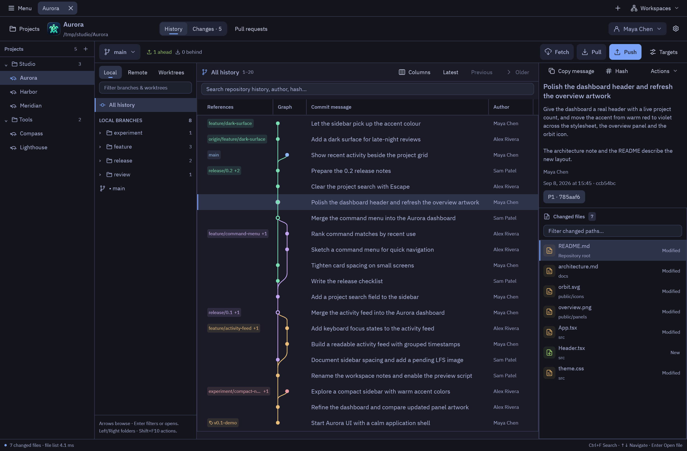
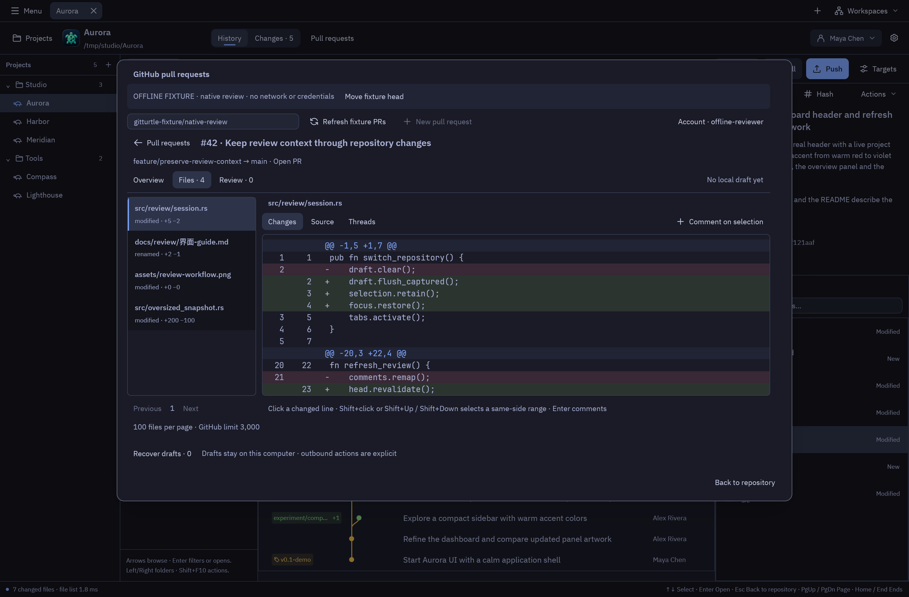
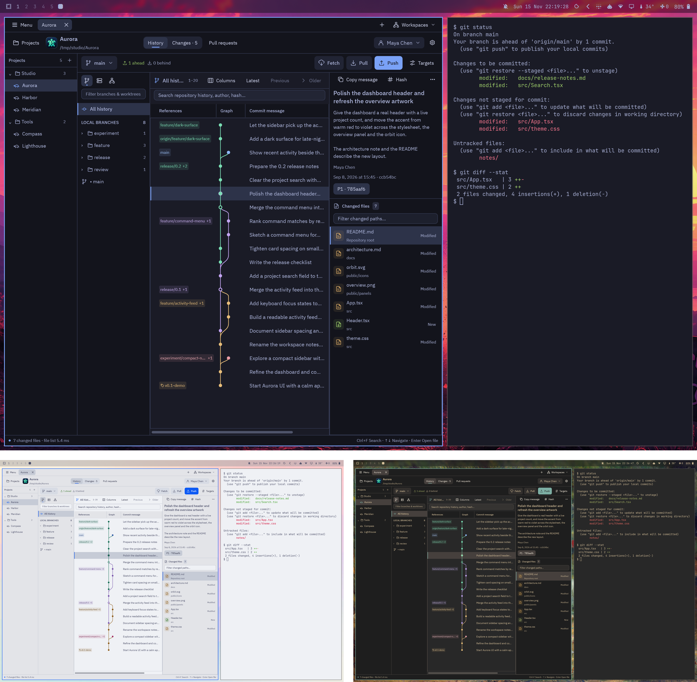
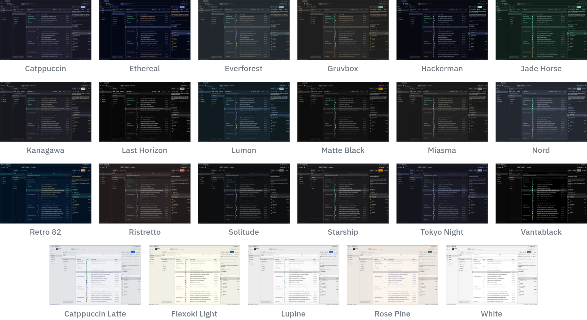

<p align="center">
  
</p>

<h1 align="center">GitTurtle</h1>

<p align="center">
  <b>A fast, calm native Git client for macOS and Linux.</b><br>
  History, diffs, staging and pull requests in one GPU-rendered Rust app — no Electron, no web view, no AI bloat.
</p>

<p align="center">
  <a href="https://github.com/FernandoX7/GitTurtle/actions/workflows/quality.yml"></a>
</p>

<p align="center">
  <a href="https://gitturtle.com/">Website</a> ·
  <a href="#measured">Speed</a> ·
  <a href="#a-tour-in-a-minute">Tour</a> ·
  <a href="#themes">Themes</a> ·
  <a href="#first-class-omarchy-support">Omarchy</a> ·
  <a href="#built-with">Stack</a> ·
  <a href="#get-started">Get started</a> ·
  <a href="docs/user-guide.md">Docs</a>
</p>

<p align="center">
  
</p>

<p align="center"><i>Captured natively on Linux at 2× display scale using a disposable demo repository.</i></p>

<table width="100%">
  <tr>
    <td align="center" width="25%"><b>115 ms</b><br><sub>Warm launch to window</sub></td>
    <td align="center" width="25%"><b>21 ms · 5 ms</b><br><sub>Commit files · history diff</sub></td>
    <td align="center" width="25%"><b>28 Languages</b><br><sub>Syntax, images, PDF &amp; 3D</sub></td>
    <td align="center" width="25%"><b>100% Native</b><br><sub>Rust 1.100.0 · GPUI · MIT</sub></td>
  </tr>
</table>

<p align="center"><sub>All timings above are <a href="#measured">measured release numbers</a> on real hardware.</sub></p>

---

## Why GitTurtle

- **Instant feel, even on huge repos.** Built in Rust with native GPU rendering and background workers, so commits, diffs and scrolling stay smooth across dozens of worktrees — keeping history bounded to **5,000 rows** or **64 MiB** however far you page.
- **Everyday power, zero clutter.** Deep history filters, Shift-click commit-range compare, right-click menus, line- and hunk-level staging and discard, drag-to-reorder interactive rebase, contextual bisect, conflict resolution, submodules and native GitHub PR review — right where you expect them, hidden until you need them.
- **Your repo stays yours.** Browsing is 100% local and read-only — it never fetches behind your back. Writes happen only when you click, guard against quitting mid-operation, and keep your real Git hooks, signing and credentials.
- **At home on your OS.** Native menu bar, Dock, Quick Look and Keychain on macOS; native Wayland/X11 and zero-config live [Omarchy](https://omarchy.org/) themes and fonts on Linux.

---

## Measured

Real `--release` timings on Apple Silicon hardware (excluding display presentation):

| What you do | Median | Environment & record |
| --- | ---: | --- |
| Warm launch to window on screen | **115 ms** | Apple M2 Pro · Linux Wayland ([record](docs/validation/2026-10.md#october-27-the-linux-interface-draws-its-real-weights)) |
| Select a commit → changed files ready | **21.2 ms** | Apple M4 Max · 653-commit repo ([record](docs/benchmarks/2026-09-08-everyday-workflows.md)) |
| Open a file from history → diff ready | **4.9 ms** | Apple M4 Max · 653-commit repo ([record](docs/benchmarks/2026-09-08-everyday-workflows.md)) |
| Scroll a 3,000-commit history *(UI CPU / notch)* | **8.2 ms** | Apple M2 Pro · Linux ([record](docs/benchmarks/2026-10-27-compact-chrome-history-scroll.md)) |
| Load the next 500 commits in a 120k history | **0.5 ms** | Apple M2 Pro · backend ([record](docs/benchmarks/2026-11-24-pre10-release-benchmarks.md)) |
| Select changed files across a 120k history | **0.8 ms** | Apple M2 Pro · backend ([record](docs/benchmarks/2026-11-24-pre10-release-benchmarks.md)) |
| Check working-tree status *(demo repo)* | **1.8 ms** | Apple M2 Pro · backend ([record](docs/benchmarks/2026-11-24-pre10-release-benchmarks.md)) |
| Selective filter over 50,000 cached History / Working paths | **0.6–0.8 ms** | Apple M2 Pro · app CPU ([record](docs/benchmarks/2026-11-24-pre10-release-benchmarks.md)) |
| Prepare intraline diffs on a 20,000-line split diff | **2.4 ms** | Apple M2 Pro · app CPU ([record](docs/benchmarks/2026-11-24-pre10-release-benchmarks.md)) |
| Quick Open across 12,000 tracked files *(5 queries)* | **4.6 ms** | Apple M2 Pro · backend ([record](docs/benchmarks/2026-11-22-wave3b-monorepo-scalability.md)) |

<sub>Each figure belongs to the build and repository in its record. See [architecture](docs/architecture.md) for how background lanes, monorepo bounds and isolated preview decoders work under the hood.</sub>

---

## A tour in a minute

<p align="center">
  
</p>

**Stage or discard down to the single line.** Review staged and unstaged changes side by side, stage or discard whole files, hunks or individual lines, add a `Signed-off-by` trailer, and use **Commit & Push** — with every worktree keeping its own saved commit draft.

<table>
  <tr>
    <td width="50%" valign="top">
      
      <p><b>Unified &amp; split diffs.</b> 28 languages with syntax highlighting, word-level diffs, Patience/Myers/Histogram matching, soft-wrap and merge-parent comparisons.</p>
    </td>
    <td width="50%" valign="top">
      
      <p><b>Deep search, zero clutter.</b> Toggle filter chips only when you need them: changed code (<code>-S</code>/<code>-G</code>), author, path, dates, regex, first-parent and non-merge commits.</p>
    </td>
  </tr>
  <tr>
    <td width="50%" valign="top">
      
      <p><b>File history &amp; blame.</b> Follow a file through renames, inspect committed or working-tree blame, and trace the history of any single line.</p>
    </td>
    <td width="50%" valign="top">
      
      <p><b>Native GitHub PR review.</b> Inspect pull requests, comment on lines or ranges, resolve threads, toggle draft/ready and merge — with local drafts that survive restarts.</p>
    </td>
  </tr>
  <tr>
    <td width="50%" valign="top">
      
      <p><b>Visual image &amp; GIF compare.</b> Side-by-side, Overlay and draggable Wipe with linked zoom and pan across PNG, JPEG, WebP, SVG, AVIF, JPEG 2000 and macOS HEIC — plus synced animated GIF playback.</p>
    </td>
    <td width="50%" valign="top">
      
      <p><b>Previews beyond code.</b> Rendered Markdown with Mermaid diagrams, searchable PDFs, CSV/TSV tables, formatted JSON/TOML/YAML and interactive 3D models (STL, OBJ, FBX, GLB, 3MF, STEP). See the <a href="docs/file-previews.md">format matrix</a>.</p>
    </td>
  </tr>
  <tr>
    <td width="50%" valign="top">
      
      <p><b>Command palette &amp; Quick Open.</b> Press <b>⌘⇧P</b> / <b>Ctrl+Shift+P</b> for any action (including your own custom commands) or <b>⌘P</b> / <b>Ctrl+P</b> to jump straight to any tracked file.</p>
    </td>
    <td width="50%" valign="top">
      
      <p><b>Keyboard-first everywhere.</b> Searchable shortcuts dialog, native macOS menu bar &amp; Dock menu, Linux <b>F10</b> menu, and built-in accessibility (<a href="docs/command-palette.md">guide</a>).</p>
    </td>
  </tr>
</table>

**Also built in:**
- **Full everyday Git:** Branches, Pull/Merge strategies, rebase, cherry-pick, revert, reset, tags, stashes and submodules.
- **Calm advanced workflows:** Native [interactive rebase](docs/interactive-rebase.md), contextual Git bisect, [block-by-block conflicts](docs/conflict-blocks.md) and [reflog recovery](docs/parallel-work-recovery.md).
- **Worktrees, tabs & profiles:** Manage linked worktrees, keep **up to eight repository and worktree tabs** open in saved workspaces, and apply named [identity profiles](docs/profiles.md).

See the [user guide](docs/user-guide.md#current-source-features) for everything included.

---

## Themes

Pick from **twenty built-in** light and dark palettes — Midnight, Braden, Tokyo Night, Catppuccin Mocha, Nord, Dracula, Solarized, Rosé Pine, Kanagawa and more — follow system appearance (and macOS accent color), or craft **up to 32 themes** in the live editor with automatic readability checks. Diffs keep ligatures off so `->`, `!=` and `--` stay unambiguous.

<p align="center">
  
</p>

<table>
  <tr>
    <td width="50%" valign="top">
      
      <p><b>One-click themes &amp; handoffs.</b> Switch palettes live and pick your favorite external editor and terminal.</p>
    </td>
    <td width="50%" valign="top">
      
      <p><b>Make it yours.</b> Build custom palettes with live contrast checks and share them as JSON.</p>
    </td>
  </tr>
</table>

---

## First-class Omarchy support

On [Omarchy](https://omarchy.org/), GitTurtle matches your desktop out of the box with zero patches or templates:

<p align="center">
  
</p>

- **Live theme & font sync:** Follows your Omarchy 3.x/4.x theme and monospace font automatically when you run `omarchy theme set` or `omarchy font set`.
- **Native shortcuts & selection:** Supports `Super+C/V/X/A`, Linux `PRIMARY` middle-click paste, and single-instance `gitturtle /path` tab handoff.
- **Zero-config tools & Hyprland craft:** Opens your Omarchy editor and terminal automatically, tiles cleanly down to 460 × 480 splits, respects reduced motion, and keeps Omarchy's window opacity.

<p align="center">
  
</p>

Add a global launch-or-focus binding to `~/.config/hypr/bindings.lua`:

```lua
o.bind("SUPER + CTRL + G", "GitTurtle", { launch = "gitturtle", focus = "com.gitturtle.GitTurtle" })
```

---

## Built with

Modern, memory-safe Rust from top to bottom — with core library versions verified against `Cargo.lock` in CI:

| Layer | Stack |
| --- | --- |
| **Core** | **Rust 1.100.0** (Edition 2024) · 7 modular crates · [Architecture](docs/architecture.md) |
| **UI & GPU** | `gpui-kit 0.10.0` · `gpui-pre 0.3.12` · `wgpu 30.0.1` *(Metal & Vulkan)* |
| **Code & Diffs** | `tree-sitter 0.26.13` *(28 grammars)* · `similar 3.2.1` |
| **Rich Previews** | `image 0.25.10` · `resvg 0.50.0` · `hayro 0.9.0` · `mermaid-rs-renderer 0.3.1` · `ufbx 0.11.5` |
| **OS & A11y** | `accesskit 0.24.1` · `objc2 0.6.4` · `ashpd 0.13.13` · `oo7 0.6.0` · `jiff 1.0.2` |

<sub>Core Git, diff, theme, prefs and GitHub crates forbid unsafe code in production, and untrusted Linux PDF, AVIF/JPEG 2000 and 3D decoders run in isolated helper processes.</sub>

---

## Get started

GitTurtle is in active pre-`v0.1.0` development with no published binaries yet — build locally in minutes (future downloads will land on [GitHub Releases](https://github.com/FernandoX7/GitTurtle/releases)). Requires Git and [Rust via rustup](https://rustup.rs/) (`rust-toolchain.toml` selects **Rust 1.100.0** automatically).

```sh
git clone https://github.com/FernandoX7/GitTurtle.git
cd GitTurtle
```

**macOS (Apple Silicon)** — requires Xcode 26+ (with Metal toolchain) & Python 3.11+:

```sh
./scripts/package-macos.sh
open dist/GitTurtle.app
```

**Arch & Omarchy (x86-64 & Apple Silicon AArch64):**

```sh
sudo pacman -S --needed rustup python-pillow cmake
./scripts/package-linux.sh
python3 dist/gitturtle-linux-$(uname -m)/install.py
```

**Ubuntu 24.04 (x86-64)** — install [build & runtime packages](docs/linux.md#build-from-source-on-ubuntu-2404) first, then run without `sudo`:

```sh
./scripts/package-linux.sh
python3 dist/gitturtle-linux-x86_64/install.py
```

**Or run straight from the checkout:**

```sh
cargo run --release --locked -p gitturtle -- /absolute/path/to/repository
```

See the [macOS guide](docs/user-guide.md#package-locally-on-macos) and [Linux guide](docs/linux.md) for stock Arch deps, upgrades, rollback and AUR/Flatpak/`.deb` recipes.

---

## Platform status

| Platform | Status |
| --- | --- |
| **macOS · Apple Silicon** | First-class target. Built, tested (macOS 15) and packaged (macOS 26) on CI for every product change; physical Mac pass on the latest UI updates pending. |
| **Linux · Arch & Omarchy (x86-64)** | Supported & verified natively on Omarchy 4.0 and 4.5 ([Nov 17 check](docs/validation/2026-11.md#november-17-the-ci-built-x86-64-archive-passes-the-omarchy-check-on-an-x86-64-omarchy-45-laptop)); tested on Arch CI. |
| **Linux · Omarchy on Apple Silicon (AArch64)** | Daily Linux dev host (M2 Pro, Wayland + Asahi Vulkan). Verified natively across workflows, live GitHub PR creation ([Nov 16](docs/validation/2026-11.md#november-16-a-live-github-sign-in-writes-no-token-and-the-app-creates-a-pull-request-end-to-end)) and the [Nov 23 UI refresh](docs/validation/2026-11.md#november-23-the-readmes-and-websites-screenshots-are-refreshed-on-omarchy-45). |
| **Linux · Ubuntu 24.04 (x86-64)** | Reference Linux CI target (built, tested, packaged & install-verified on every product change); physical Ubuntu GNOME desktop pass pending. |

Full build logs and honest caveats live in [validation](docs/validation.md), [current limits](docs/user-guide.md#current-limits), and [Linux limits](docs/linux.md#platform-limits).

**Good to know today:** builds are unsigned pre-release packages (with 7-day Linux [CI test artifacts](docs/ci-artifacts.md#find-and-verify-a-download) and in-repo [`packaging/aur`](packaging/aur/README.md)/`.deb`/Flatpak recipes); HEIC and full Quick Look require macOS; Linux Wayland/X11 IME and AT-SPI accessibility parity is covered by automated checks with live Orca/`fcitx5`/`IBus` desktop sessions still pending; and live PR commenting/merging on Linux plus live GitHub sign-in on macOS are awaiting physical checks.

---

## Docs & community

[User guide](docs/user-guide.md) · [Linux setup](docs/linux.md) · [macOS conventions](docs/macos-features.md) · [Preview formats](docs/file-previews.md) · [Architecture](docs/architecture.md) · [Design](DESIGN.md) · [Contributing](CONTRIBUTING.md) · [Issues](https://github.com/FernandoX7/GitTurtle/issues/new/choose) · [Get help](SUPPORT.md) · [Security](SECURITY.md) · [Code of conduct](CODE_OF_CONDUCT.md)

## Support the project

GitTurtle is free, open source, and built with zero telemetry or subscriptions. If it makes your day faster, star the repo or [sponsor development on GitHub](https://github.com/sponsors/FernandoX7). Contributions of all sizes are welcome — see [CONTRIBUTING.md](CONTRIBUTING.md).

## License

[MIT](LICENSE) · Third-party crates and assets retain their own terms ([THIRD_PARTY_NOTICES.md](THIRD_PARTY_NOTICES.md)).
