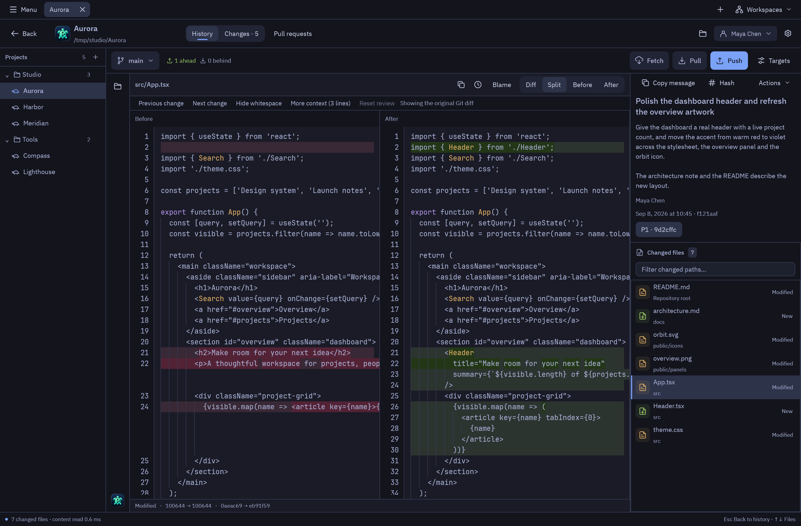
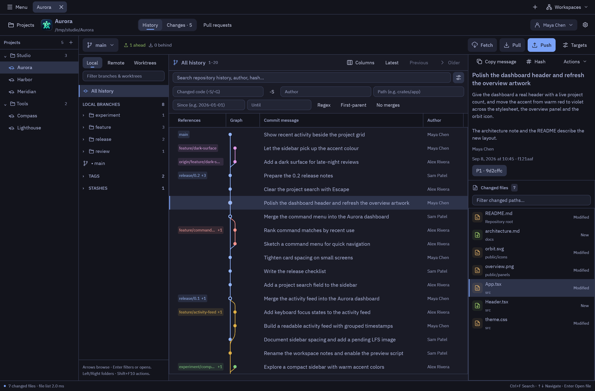
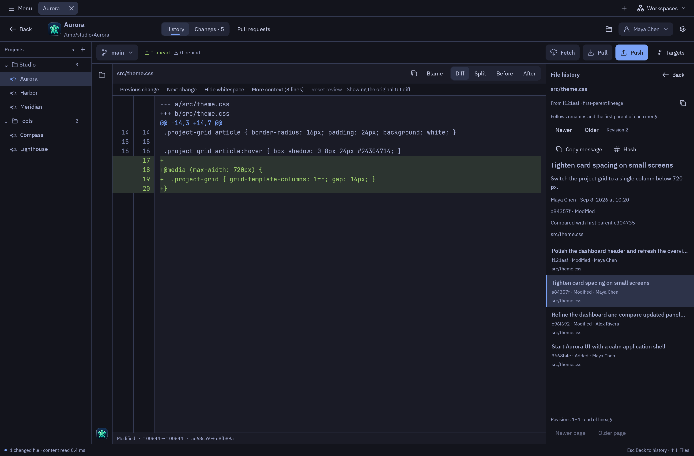
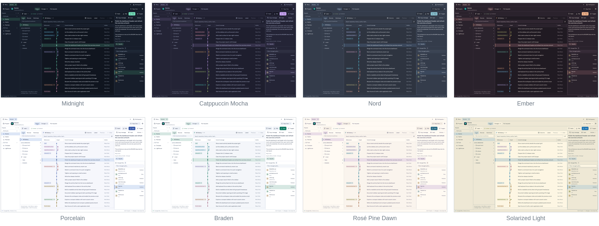
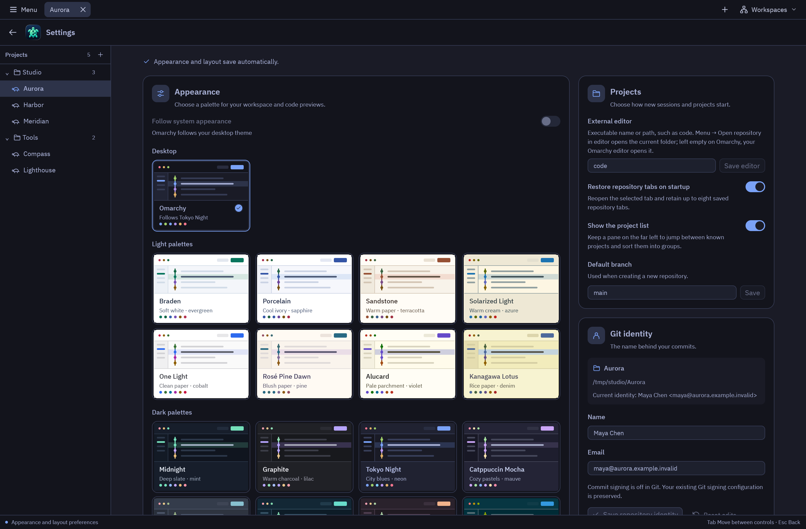
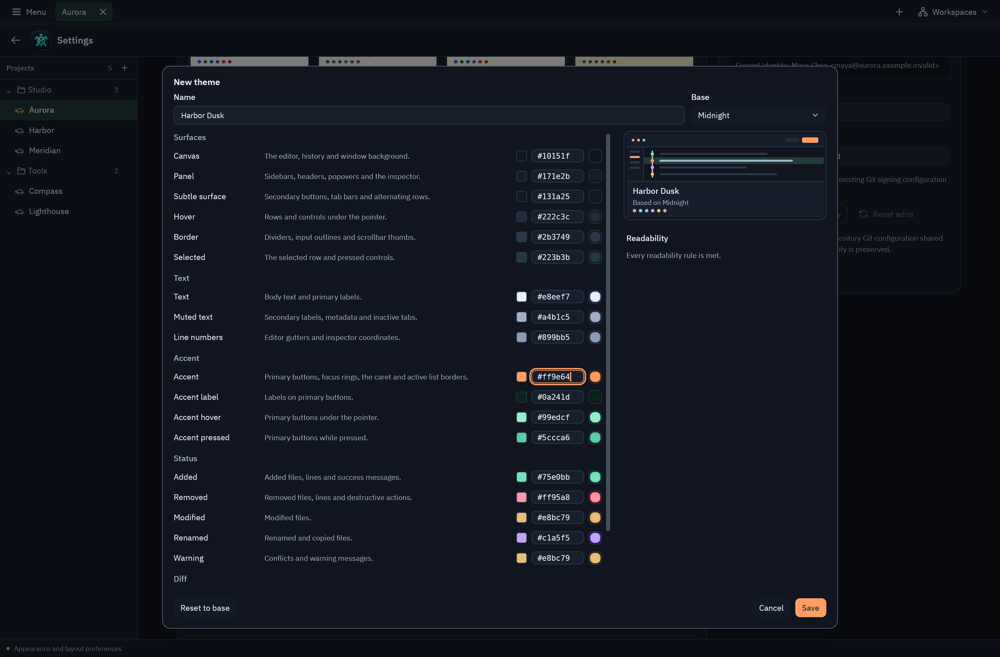

<p align="center">
  
</p>

<h1 align="center">GitTurtle</h1>

<p align="center">
  <b>A calmer, faster native Git client for macOS and Linux.</b><br>
  Pure Rust and GPUI — GPU-rendered, local-first, with no Electron, no web view and no AI features.
</p>

<p align="center">
  <a href="https://github.com/FernandoX7/GitTurtle/actions/workflows/quality.yml"></a>
</p>

<p align="center">
  <a href="https://gitturtle.com/">Website</a> ·
  <a href="#why-gitturtle">Why GitTurtle</a> ·
  <a href="#measured">Benchmarks</a> ·
  <a href="#a-tour-in-a-minute">Tour</a> ·
  <a href="#themes">Themes</a> ·
  <a href="#first-class-omarchy-support">Omarchy</a> ·
  <a href="#architecture-and-tech-stack">Tech stack</a> ·
  <a href="#get-started">Get started</a> ·
  <a href="docs/user-guide.md">User guide</a>
</p>

<p align="center">
  
</p>

<p align="center"><i>Every screenshot on this page shows a disposable demo repository, captured natively on Linux at 2× display scale.</i></p>

<table width="100%">
  <tr>
    <td align="center" width="25%"><b>115 ms</b><br><sub>Warm launch to mapped window</sub></td>
    <td align="center" width="25%"><b>21 ms · 5 ms</b><br><sub>Commit file list · text diff ready</sub></td>
    <td align="center" width="25%"><b>−20% to −98%</b><br><sub>Core Git &amp; monorepo pipeline gains</sub></td>
    <td align="center" width="25%"><b>Zero Electron</b><br><sub>Rust 1.100.0 · GPUI · MIT</sub></td>
  </tr>
</table>

<p align="center"><sub>All timings are <a href="#measured">recorded release measurements</a> on real hardware, not estimates.</sub></p>

---

## Why GitTurtle

Most Git clients make you choose between a sluggish browser shell and a cluttered wall of toolbars. **GitTurtle** is built from scratch in Rust with GPU-accelerated GPUI rendering so history inspection, code review and everyday Git work feel instantaneous, calm and trustworthy — using the `git` binary, hooks, signing and credential helpers you already have.

- **Fast on real repos and many worktrees.** Reads, diffs, parsing and decoding run off the UI thread across a two-lane worker (`metadata` and `preview`) backed by a persistent pipelined `git cat-file` pool. Lists virtualize, straight commit-graph lanes paint as GPU quads, and history stays bounded to **5,000 rows** or **64 MiB** however deep you page.
- **Everyday power without toolbar clutter.** Collapsible history filter chips (`-S`/`-G`, author, path, date range, regex, first-parent, no merges), right-click commit/branch/stash menus, line- and hunk-level staging and discard, 28 Tree-sitter syntax grammars, native interactive rebase, contextual bisect (shown only while active), conflict blocks, submodules and native GitHub PR review.
- **Strictly respectful of your repository.** Browsing, watching and focus refreshes stay local and read-only (`GIT_NO_LAZY_FETCH=1`, `GIT_OPTIONAL_LOCKS=0`, disabled helpers and filters). Writes and network actions require an explicit click, run serially against their captured target, guard against mid-write close or quit, and never silently retry an uncertain outcome.
- **Native craft on macOS, Linux and Omarchy.** AppKit menus, resident Dock lifecycle, Quick Look, Data Protection Keychain and system accent color on macOS; Wayland/X11, seccomp-confined preview helpers, `PRIMARY` middle-click paste, single-instance tab handoff and live zero-config [Omarchy](https://omarchy.org/) 3.x/4.x theme and font sync on Linux.

---

## Measured

Every number below comes from a checked-in `--release` benchmark or timing record on real hardware. None includes OS input delivery or display presentation, and each belongs strictly to the build and repository named in its record.

### Interactive UI & long-history benchmarks

| Release measurement | Median | 95th percentile | Record |
| --- | ---: | ---: | --- |
| Warm launch from executable start to mapped window *(M2 Pro · Omarchy Wayland)* | **115 ms** | 103–135 ms range | [Oct 2026 check](docs/validation/2026-10.md#october-27-the-linux-interface-draws-its-real-weights) |
| Select a commit → changed-file list ready *(M4 Max · 653-commit repo)* | **21.2 ms** | 45.2 ms | [Everyday workflows](docs/benchmarks/2026-09-08-everyday-workflows.md) |
| Open a text file from history → diff ready *(M4 Max · 653-commit repo)* | **4.9 ms** | 7.4 ms | [Everyday workflows](docs/benchmarks/2026-09-08-everyday-workflows.md) |
| Load each next 500-commit page in a 120,000-commit history *(M4 Max · backend)* | **0.5 ms** | 0.6 ms | [History pagination](docs/benchmarks/2026-09-10-history-pagination.md) |
| Scroll a 3,000-commit history: UI-thread CPU per wheel notch *(M2 Pro · Linux · 1480 × 800)* | **8.2 ms** | 13.2 ms | [History scroll](docs/benchmarks/2026-10-27-compact-chrome-history-scroll.md) |

### Core Git & monorepo pipeline speedups (November 2026)

Same-session alternating `--release` benchmarks on Apple M2 Pro P-cores (`taskset -c 4-11`, Omarchy Linux) across a 500-commit repo, a 12,000-file repo, a 4,000-commit search fixture and a 16 MiB PDF helper transfer ([Wave 3A](docs/benchmarks/2026-11-22-wave3a-performance-wins.md), [Wave 3B](docs/benchmarks/2026-11-22-wave3b-monorepo-scalability.md)):

| Operation | Before | After | Speedup |
| --- | ---: | ---: | ---: |
| Operation-state detection *(zero Git spawns)* | 0.77 ms | **0.02 ms** | **−97.9%** |
| 20 embedded Markdown images *(pipelined `cat-file` pool)* | 33.24 ms | **2.93 ms** | **−91.2%** |
| List 4 remotes with `insteadOf` *(single spawn)* | 6.51 ms | **0.77 ms** | **−88.1%** |
| Quick Open, 5 queries across 12,000 tracked files | 15.45 ms | **4.62 ms** | **−70.1%** |
| Linux confined PDF helper transfer *(16 MiB, sealed `memfd_create`)* | 13.70 ms | **4.96 ms** | **−63.8%** |
| History search, 3 continued pages *(4,000 commits)* | 63.87 ms | **28.06 ms** | **−56.1%** |
| Local watch policy scan *(500 commits / 12,000 files)* | 3.43 / 9.97 ms | **1.54 / 6.48 ms** | **−55.1% / −35.0%** |
| Open repository metadata | 2.15 ms | **1.42 ms** | **−33.7%** |
| 50 paired text-diff blob reads *(pipelined)* | 6.78 ms | **4.52 ms** | **−33.4%** |
| Working status *(standard repository)* | 2.70 ms | **1.83 ms** | **−32.2%** |
| Working-file blame *(420 lines)* | 12.38 ms | **9.21 ms** | **−25.6%** |
| Partial hunk staging | 6.19 ms | **4.96 ms** | **−19.9%** |

> **Monorepo & memory safeguards:** Unbounded untracked directories (such as a 12,000-file `node_modules/` tree) collapse under a fixed probe budget — shrinking status rows from **12,003 → 4** while still expanding small sibling directories. Large repositories degrade local watching cleanly to Git metadata directories (`GitMetadataOnly`), image decoding swizzles RGBA→BGRA in place with zero duplicate CPU buffers, and split diffs, Settings and theme cards stay lazy until opened.

---

## A tour in a minute

**History and graph.** Read a clean commit graph with expandable local/remote branch trees, tags and stashes in the sidebar alongside each commit's message, parent switcher and changed files. Selecting a commit loads only its changed-file list; opening a file is always your call, and **Back** restores your exact history position and scroll offset.

<p align="center">
  
</p>

**Stage or discard down to the single line.** Stage, unstage or discard whole files, individual hunks or exact changed lines with staged and unstaged lists cleanly separated. Insert a DCO `Signed-off-by` trailer, pick explicit Pull and Merge strategies, use **Commit & Push**, and switch branches or worktrees without losing work — every worktree keeps its own durable commit draft.

<table>
  <tr>
    <td width="50%" valign="top">
      
      <p><b>Unified &amp; split diffs.</b> 28 Tree-sitter syntax grammars, intra-line word highlights, selectable Patience, Myers and Histogram diff algorithms, configurable tab width (2/4/8) and soft-wrap. Compare any two revisions, a merge base or a merge's parents.</p>
    </td>
    <td width="50%" valign="top">
      
      <p><b>Deep history filters on demand.</b> Toggle filter controls beside search to narrow by changed code (<code>-S</code>/<code>-G</code>), author, path, date range, regex, first-parent or non-merge commits — completely hidden until you need them.</p>
    </td>
  </tr>
  <tr>
    <td width="50%" valign="top">
      
      <p><b>File history, blame &amp; line lineage.</b> Follow a file across renames, inspect committed or uncommitted blame per line, and trace the history of any single line without losing your current view.</p>
    </td>
    <td width="50%" valign="top">
      
      <p><b>Native GitHub pull-request review.</b> Connect GitHub.com via the GitHub CLI to inspect changed files, comment on lines or multi-line ranges, resolve threads, switch draft/ready state, and submit reviews or merge pull requests explicitly — with local drafts that survive restarts.</p>
    </td>
  </tr>
  <tr>
    <td width="50%" valign="top">
      
      <p><b>Pixel-accurate image &amp; GIF compare.</b> Compare PNG, JPEG, WebP, GIF, SVG, BMP, TIFF, ICO, AVIF, JPEG 2000 (and macOS HEIC) side by side, as an overlay or with a draggable wipe, with linked zoom and pan. Animated GIFs play both sides on one clock.</p>
    </td>
    <td width="50%" valign="top">
      
      <p><b>Rich previews beyond text.</b> Rendered CommonMark/GFM Markdown with native Mermaid diagrams, multi-page PDF with text extraction and document search, CSV/TSV tables, formatted JSON/TOML/YAML, and interactive 3D models (STL, OBJ, FBX, GLB 2.0, 3MF and faceted/CSG STEP). See the <a href="docs/file-previews.md">format matrix</a>.</p>
    </td>
  </tr>
  <tr>
    <td width="50%" valign="top">
      
      <p><b>Command palette &amp; custom commands.</b> <b>⌘⇧P</b> on macOS or <b>Ctrl+Shift+P</b> on Linux reaches every action (including user-configured no-shell custom commands); unavailable commands stay visible and explain why. <b>⌘P</b> / <b>Ctrl+P</b> Quick-Opens any tracked file.</p>
    </td>
    <td width="50%" valign="top">
      
      <p><b>Keyboard-first &amp; accessible.</b> A searchable Keyboard Shortcuts dialog lists every binding for your OS. macOS gets a native menu bar and resident Dock menu; Linux gets a top-left <b>Menu</b> (<b>F10</b>). Built on AccessKit for VoiceOver and AT-SPI. See <a href="docs/command-palette.md">keyboard navigation</a>.</p>
    </td>
  </tr>
</table>

### Everything else built in

- **Everyday Git, deliberately.** Branch, merge (fast-forward, no-FF, squash), pull (FF-only, merge, rebase, autostash), rebase, cherry-pick, revert, reset, stash browser, tag, and submodule inspect/init/update/sync — plus native [interactive rebase](docs/interactive-rebase.md) and a contextual Git bisect banner that appears only while a bisect session is active.
- **Conflicts and recovery.** Resolve [conflicts block by block](docs/conflict-blocks.md) with per-worktree drafts, safely undo an eligible last local commit, and browse the reflog to spin up a [recovery branch](docs/parallel-work-recovery.md) without disturbing working files.
- **Worktrees, tabs and workspaces.** Create and remove linked worktrees through an explicit review, keep **up to eight repository and worktree tabs** open side by side, and save tab sets as named workspaces.
- **Named identity profiles.** Save author and signing profiles and preview every repo-local config edit before applying it ([profiles](docs/profiles.md)).
- **Explicit GitHub collaboration.** Review PRs natively with OS keychain/keyring storage and zero background token writes ([GitHub collaboration](docs/github-collaboration.md); see [limits](#limits-and-whats-next)).

See the [user guide](docs/user-guide.md#current-source-features) for the complete feature list and bounds.

---

## Themes

Choose from **twenty built-in** light and dark themes — including Midnight, Braden, Porcelain, Sandstone, Graphite, Tokyo Night, Catppuccin Mocha, Nord, Deep Sea, Ember, Solarized, One Dark/Light, Rosé Pine, Dracula/Alucard and Kanagawa — or follow system appearance (and your macOS system accent color). Set interface and code font sizes separately, pick comfortable or compact density, and enjoy crisp diffs with ligatures turned off so `->`, `!=` and `--` never merge into a single glyph.

<p align="center">
  
</p>

<table>
  <tr>
    <td width="50%" valign="top">
      
      <p><b>Pick in one click.</b> Every theme previews live as a card in Settings, alongside external editor, external terminal and per-repository Git identity settings.</p>
    </td>
    <td width="50%" valign="top">
      
      <p><b>Or design your own.</b> Create <b>up to 32 themes</b> in the built-in editor with live OKLab/WCAG contrast checks, and import or share palettes as JSON files.</p>
    </td>
  </tr>
</table>

On Linux, code renders with bundled DejaVu Sans Mono or your desktop's monospace font when **Use the desktop's monospace font** is enabled in Settings.

---

## First-class Omarchy support

On an [Omarchy](https://omarchy.org/) desktop, GitTurtle feels native from the very first launch. It needs no Omarchy patch or template: it reads your active theme's colors directly — hand-written and community themes included — and never mutates your desktop config.

<p align="center">
  
</p>

- **Your theme, live.** First launch selects the **Omarchy** theme, following your current Omarchy 3.x or 4.x theme automatically. `omarchy theme set` retints the open window in place, adjusting contrast in OKLab where needed so diffs stay legible.
- **Your font.** Code follows your Omarchy monospace font, updating live on `omarchy font set`.
- **Your keys and selection.** Omarchy's `Super+C`, `Super+V`, `Super+X` and `Super+A` work across text inputs; `Super+C` also copies a selected commit hash or file path from lists; selecting non-masked text updates Linux's `PRIMARY` selection for middle-click paste.
- **Your tools.** With no override set in Settings, **Open repository in editor** uses your Omarchy editor and **Open repository in terminal** opens your default terminal in the repository. Launching `gitturtle /path/to/repo` hands off cleanly to the running instance and focuses that repository in a tab.
- **At home in Hyprland.** Native Wayland client that tiles cleanly down to 460 × 480 splits, honors Hyprland's animation setting for reduced motion, keeps Omarchy's default window opacity, and draws no redundant title bar.

<p align="center">
  
</p>

Bind a global launch-or-focus shortcut in `~/.config/hypr/bindings.lua`:

```lua
o.bind("SUPER + CTRL + G", "GitTurtle", { launch = "gitturtle", focus = "com.gitturtle.GitTurtle" })
```

`Super+Ctrl+G` is free in Omarchy 4.5's default bindings. Since version 4.5, Omarchy runs natively on Apple Silicon MacBooks ([omarchy.org](https://omarchy.org/)), and GitTurtle's Linux work is developed and exercised daily on an M2 Pro MacBook Pro running Omarchy 4.5.

---

## Architecture and tech stack

GitTurtle is structured as a modular **7-crate Rust workspace** so core Git logic, diff/graph layout, themes, persistence and GitHub transport compile, lint and test independently of GPUI:

| Crate | Responsibility | Safety boundary |
| --- | --- | --- |
| `crates/git-core` (`gitturtle-core`) | Passive/explicit Git execution, byte-safe paths, pipelined `BatchPool`, partial staging, LFS, recovery | `#![forbid(unsafe_code)]` · `deny(clippy::unwrap_used)` |
| `crates/diff-model` (`gitturtle-diff-model`) | Headless commit-graph layout, patch & aligned split diffs, partial-staging line views | `#![forbid(unsafe_code)]` · `deny(clippy::unwrap_used)` |
| `crates/preview` (`gitturtle-preview`) | Bounded in-memory image/GIF/SVG/PDF/Mermaid/3D decoding & confined helper decoders | `deny(clippy::unwrap_used)` · framed helper protocol |
| `crates/theme` (`gitturtle-theme`) | Semantic palettes, OKLab/WCAG contrast, 20 built-in + custom & Omarchy themes | `#![forbid(unsafe_code)]` · `deny(clippy::unwrap_used)` |
| `crates/prefs` (`gitturtle-prefs`) | Atomic serialized settings, project library, identity profiles, recovery drafts | `#![forbid(unsafe_code)]` *(production)* · `deny(clippy::unwrap_used)` |
| `crates/github` (`gitturtle-github`) | GitHub PR API transport, OS keychain/keyring integration, durable drafts & attempt logs | `#![forbid(unsafe_code)]` · `deny(clippy::unwrap_used)` |
| `crates/app` (`gitturtle`) | Native GPUI views, 2-lane worker, shortcuts, accessibility, Linux seccomp runner & OS integration | Serialized writes · generation-checked async replies |

### Security & defense in depth

- **Seccomp-confined Linux decoders:** Untrusted PDF (`hayro`), AVIF (`mp4parse` + dynamically loaded `libdav1d.so.7`), JPEG 2000 (`hayro-jpeg2000`) and 3D `.obj`/`.fbx`/GLB meshopt (`ufbx`, `meshopt`) payloads decode in short-lived Linux helper processes locked down with seccomp, fed over sealed `memfd_create` descriptors, capped at two slots with a 10 s deadline and 25 ms cancellation kill.
- **Safe native macOS FFI:** Uses typed `objc2` bindings (`AppKit`, `Foundation`, `CoreGraphics`, `QuickLookUI`) and `security-framework` Keychain APIs with zero raw `objc_msgSend` transmutes.
- **Zero-trust repository reads:** Passive commands disable external diff/textconv/clean filters, hooks, lazy fetches and optional locks; stored symlinks are rendered as literal text and never followed.
- **Continuous verification:** CI verifies product and dependency changes across macOS 15/26, Ubuntu 24.04 and Arch Linux with `cargo clippy -- -D warnings`, `cargo-deny` license and advisory checks, and deterministic `proptest` suites, complemented by opt-in `fuzz/` libFuzzer harnesses ([architecture](docs/architecture.md)).

### Core dependencies & pinned versions

Tracked automatically against `rust-toolchain.toml` and `Cargo.lock` in CI:

| Layer | Pinned versions | Role |
| --- | --- | --- |
| **Language & toolchain** | **Rust 1.100.0** · Edition 2024 | Thin-LTO release builds, workspace lints |
| **Native UI & GPU** | `gpui-kit 0.10.0` · `gpui-pre 0.3.12` · `wgpu 30.0.1` | Native GPU rendering (Metal on macOS, Vulkan/GLES on Linux) |
| **Syntax & diffs** | `tree-sitter 0.26.13` (28 grammars) · `similar 3.2.1` | Syntax highlighting; Patience, Myers & Histogram diffs |
| **Accessibility** | `accesskit 0.24.1` · `accesskit_macos 0.26.3` · `accesskit_unix 0.22.1` | Native VoiceOver (macOS) & AT-SPI (Linux, partial) accessibility trees |
| **OS integration & secrets** | `objc2 0.6.4` · `security-framework 3.7.0` · `ashpd 0.13.13` · `oo7 0.6.0` · `rustix 1.1.6` | AppKit/Keychain/Quick Look; XDG portals, Secret Service & `memfd_create` |
| **Images, PDF & Markdown** | `image 0.25.10` · `resvg 0.50.0` · `hayro 0.9.0` · `hayro-jpeg2000 0.5.0` · `markdown 1.0.0` · `mermaid-rs-renderer 0.3.1` | Raster/GIF/SVG, Linux confined PDF & JPEG 2000, CommonMark/GFM & static Mermaid |
| **3D / CAD inspection** | `ufbx 0.11.5` · `meshopt 0.7.0` · `stl_io 0.11.0` | Interactive STL, OBJ, FBX, GLB 2.0, 3MF & faceted/CSG STEP |
| **Time, watch & integrity** | `jiff 1.0.2` · `notify 8.2.0` · `ignore 0.4.34` · `sha2 0.11.1` | Timestamp formatting, coalesced local watch, ignore rules, LFS SHA-256 checks |

---

## Get started

GitTurtle is in active pre-`v0.1.0` development with no published binaries yet — **build and package it directly from source**. Prebuilt releases will be announced on [GitHub Releases](https://github.com/FernandoX7/GitTurtle/releases). You need Git and [Rust via rustup](https://rustup.rs/); `rust-toolchain.toml` selects **Rust 1.100.0** automatically.

```sh
git clone https://github.com/FernandoX7/GitTurtle.git
cd GitTurtle
```

### macOS · Apple Silicon

Requires Xcode 26 or later (including its Metal toolchain) and Python 3.11+:

```sh
./scripts/package-macos.sh
open dist/GitTurtle.app
```

Creates a locally ad-hoc-signed Apple Silicon `.app` bundle (not notarized; Intel Macs are not targeted). See the [macOS packaging guide](docs/user-guide.md#package-locally-on-macos) and [macOS conventions](docs/macos-features.md).

### Linux · Arch and Omarchy (x86-64 & AArch64)

Omarchy already ships the runtime libraries GitTurtle needs. Install three build tools, then package and install under `~/.local`:

```sh
sudo pacman -S --needed rustup python-pillow cmake
./scripts/package-linux.sh
python3 dist/gitturtle-linux-$(uname -m)/install.py
```

Works identically on x86-64 and [Apple Silicon MacBooks running Omarchy](docs/linux.md#omarchy-on-apple-silicon-aarch64). On stock Arch Linux, install the [additional packages](docs/linux.md#arch-linux-and-omarchy) listed in the Linux guide first.

### Linux · Ubuntu 24.04 (x86-64)

Install the [runtime and build dependencies](docs/linux.md#build-from-source-on-ubuntu-2404), then package and install:

```sh
./scripts/package-linux.sh
python3 dist/gitturtle-linux-x86_64/install.py
```

Run the installer **without `sudo`**, then open **GitTurtle** from your app launcher. The [Linux guide](docs/linux.md) covers checksums, bundle transfer, upgrades, rollback, `.deb`/Flatpak/AUR recipes and uninstalling.

### Launch directly from a checkout

```sh
cargo run --release --locked -p gitturtle -- /absolute/path/to/repository
```

Select a commit to inspect its changed files; activate a file to compare it; press **Esc** / **Back** to return with your exact scroll position intact.

---

## Platform status

| Platform | Verified status |
| --- | --- |
| **macOS · Apple Silicon** | First-class target. CI builds and runs the full test suite on macOS 15 and packages on macOS 26 for every product change. Recent appearance, theme-editor and macOS lifecycle refinements have been verified on hosted macOS CI and natively on Linux, with a physical Mac desktop pass still pending. |
| **Linux · Ubuntu 24.04, x86-64** | Reference Linux target. CI builds, tests, packages, installs and verifies transfer archives on Ubuntu 24.04 for every product change, alongside clean userspace install checks. **A full physical Ubuntu GNOME desktop pass is still pending.** |
| **Linux · Arch and Omarchy, x86-64** | Supported, with first-class Omarchy integration. Checked natively on Omarchy 4.0 and 4.5 ([November 17 check](docs/validation/2026-11.md#november-17-the-ci-built-x86-64-archive-passes-the-omarchy-check-on-an-x86-64-omarchy-45-laptop)): CI x86-64 archive install, `gitturtle-bin` build, live tracking across 23 stock themes, desktop font sync, tiled/floating/half-width layouts, scale 2, `Super+C`/`Super+V` and folder picker (fractional scales 1.25/1.5 checked on 4.0). CI builds and tests against current Arch Linux packages. |
| **Linux · Omarchy on Apple Silicon (AArch64)** | Daily Linux development host (M2 Pro MacBook Pro, native Wayland + Mesa Asahi Vulkan). Checked natively across packaging, install, live theme/font switches, staging ([November 15](docs/validation/2026-11.md#november-15-the-ptr-a-and-ptr-b-build-passes-natively-on-omarchy-45-and-the-ci-built-aarch64-archive-installs-and-runs-as-the-local-build-does)), live GitHub sign-in & PR creation ([November 16](docs/validation/2026-11.md#november-16-a-live-github-sign-in-writes-no-token-and-the-app-creates-a-pull-request-end-to-end)), and the [November 23 refresh](docs/validation/2026-11.md#november-23-the-readmes-and-websites-screenshots-are-refreshed-on-omarchy-45) across history, search filters, compare, staging, previews, custom themes and offline PR review. Hosted ARM CI builds and packages AArch64 releases. |

All checked builds and environments are logged in [validation](docs/validation.md) and the [Linux guide](docs/linux.md#arch-linux-and-omarchy). A green CI run never stands in for a physical desktop check.

---

## Limits and what's next

GitTurtle is honest about what is ready today and what comes next:

- **Pre-release distribution:** No published binaries, Apple notarization or automatic updates yet. Local macOS bundles are ad-hoc signed and Linux bundles are unsigned. Each green Quality release run retains its verified Linux x86-64 and AArch64 archives as [seven-day Actions artifacts](docs/ci-artifacts.md#find-and-verify-a-download). Packaging recipes for AUR (`gitturtle-bin` in [`packaging/aur`](packaging/aur/README.md)), local `.deb` and Flatpak are prepared in-repo and not yet published.
- **Linux platform boundaries:** AVIF, JPEG 2000, PDF and native 3D `ufbx`/`meshopt` decode inside seccomp-confined helpers (AVIF loads optional `libdav1d.so.7` via `dlopen`; animated AVIF shows its first frame and AVIF image grids are not yet decoded; HEIC requires macOS). Linux **Open in default app** intentionally permits only passive byte-verified formats (raster images, PDF and plain text in Diagrams/3D headers), never diffs or rendered Markdown. Screen-reader and IME support on Linux remain partial.
- **GitHub pull-request review:** Live sign-in, clean disconnect/reconnect and end-to-end PR creation passed on Omarchy 4.5 ([November 16 check](docs/validation/2026-11.md#november-16-a-live-github-sign-in-writes-no-token-and-the-app-creates-a-pull-request-end-to-end)); live commenting, review submission and merging on Linux — plus live sign-in on macOS — are awaiting physical desktop verification.
- **Bounded Git workflows:** Merge-preserving/root rebases and adding or removing submodules stay with the Git CLI (GitTurtle handles submodule inspection and explicit init, update and sync). Previews, history windows and partial staging enforce explicit size caps rather than silently truncating edits.

Read [Linux platform limits](docs/linux.md#platform-limits) and [current feature limits](docs/user-guide.md#current-limits) before relying on an edge workflow. **Next up:** prebuilt releases, physical desktop passes on Ubuntu GNOME and macOS, and signed distribution.

---

## Documentation and community

- **Guides:** [User guide](docs/user-guide.md) · [Linux setup](docs/linux.md) · [macOS conventions](docs/macos-features.md) · [Preview format matrix](docs/file-previews.md) · [Authentication](docs/authentication.md)
- **Engineering:** [Architecture](docs/architecture.md) · [Design system](DESIGN.md) · [Contributing](CONTRIBUTING.md) · [Validation records](docs/validation.md)
- **Community:** [Report a bug or suggest a feature](https://github.com/FernandoX7/GitTurtle/issues/new/choose) · [Get help](SUPPORT.md) · [Security policy](SECURITY.md) · [Code of conduct](CODE_OF_CONDUCT.md)

## Support the project

GitTurtle is free, open source, and built in the open without telemetry or subscriptions. If it speeds up your day, consider [sponsoring development on GitHub](https://github.com/sponsors/FernandoX7) or starring the repository to help others discover it.

Bug reports, macOS/Linux desktop testing, documentation improvements and focused pull requests of any size are warmly welcome — see [CONTRIBUTING.md](CONTRIBUTING.md).

## License

GitTurtle is [MIT licensed](LICENSE). Third-party crates and assets retain their own terms; see [THIRD_PARTY_NOTICES.md](THIRD_PARTY_NOTICES.md).
